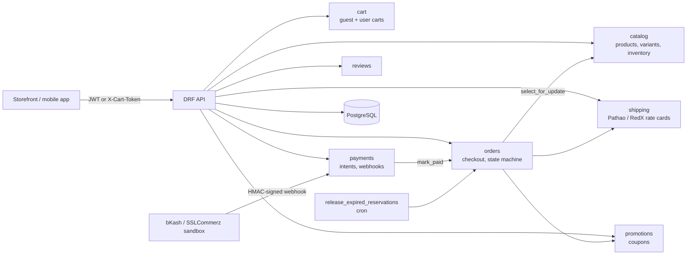

<!-- topics: django,django-rest-framework,python,ecommerce,rest-api,bkash,inventory,coupons,bangladesh -->
# E-commerce API

Django + DRF backend for a Bangladesh retail storefront: catalogue, guest and user carts, checkout with locked stock reservations, bKash / SSLCommerz / cash-on-delivery payments, Pathao and RedX shipping rates, coupons and reviews.

[](https://github.com/AkibUllah/ecommerce-api/actions/workflows/ci.yml)


## Try it live

| | |
|---|---|
| API reference | https://akibullah.github.io/ecommerce-api/ — Swagger UI built from the drf-spectacular schema (static; no backend behind it) |
| Run in your browser | [](https://codespaces.new/AkibUllah/ecommerce-api?quickstart=1) — starts API + reservation sweeper + PostgreSQL with `docker compose` and runs `seed_demo`; open forwarded port 8000 at `/api/docs/` (Swagger) or `/admin/` (`admin` / `admin12345`). |
| One-click deploy | [](https://render.com/deploy?repo=https://github.com/AkibUllah/ecommerce-api) — `render.yaml` provisions the web service and a free PostgreSQL; the container migrates and seeds the demo catalogue on start, secrets are generated. |
| Local | `docker compose up` (see Quick Start) |

## Why this exists

Most Bangladeshi e-commerce backends I have worked on got the same three things wrong: overselling the last unit during a flash sale, computing VAT and courier fees in floating point, and treating a payment webhook as trusted input. This project is the checkout core I would want to start from: stock is reserved under a row lock and expires if the customer never pays, every amount is a `Decimal`, and provider callbacks are HMAC-verified, deduplicated and amount-checked before an order is confirmed. Shipping and payment providers sit behind small adapter protocols so the sandbox stubs can be swapped for live integrations without touching the order flow.

## Features

- Catalogue with nested categories, product variants (SKU, attributes, price override, weight), images and per-variant inventory; filtering, full-text search and ordering
- Guest carts via an `X-Cart-Token` header, user carts via JWT, and a merge endpoint for post-login carts (quantities summed, capped at available stock)
- Checkout in one transaction: `select_for_update` inventory locks in PK order, stock reservation with a configurable TTL, coupon application, zone-based courier fee and VAT
- Order state machine (`pending -> confirmed -> processing -> shipped -> delivered`, plus `cancelled`, `expired`, `refunded`) with an audit history row per transition and invalid transitions rejected
- Payment intents and provider webhooks for bKash and SSLCommerz (sandbox adapters), cash on delivery confirmed at checkout; webhooks are signature-verified, idempotent by event id and fail on amount mismatch
- Pathao and RedX rate calculators by zone (inside / outside Dhaka), parcel weight and COD collection fee
- Coupons: percentage (with cap), fixed amount and free shipping, with minimum order, validity window, global and per-user usage limits; usage is reverted on cancellation or expiry
- Reviews with one-per-user-per-product, verified-purchase flag derived from delivered orders, rating aggregate on the product
- `release_expired_reservations` management command (cron-friendly, no Celery) and an idempotent `seed_demo` command with a Bangla-labelled catalogue priced in BDT
- JWT auth (simplejwt), uniform JSON error envelope, OpenAPI schema and Swagger UI, admin for every model, `/health/` probe

## Architecture



Key decisions:

- **Reserve, then commit.** `Inventory` tracks `quantity` and `reserved`; checkout only bumps `reserved` under a row lock. A successful payment commits (decrements both), cancellation or expiry releases. Available stock is always `quantity - reserved`, so an unpaid order can never block the shelf forever.
- **Pricing is a pure function.** `orders.services.price_order` takes subtotal, discount, shipping and VAT rate and returns a breakdown; it is unit-tested independently of the database. VAT is charged on discounted goods only, courier fees pass through.
- **Adapters, not conditionals.** `PaymentAdapter` and `RateCalculator` are `Protocol`s. The shipped implementations are sandbox stubs that keep the real providers' field names (`paymentID`/`trxID`, `tran_id`/`val_id`) so a live adapter is a drop-in.
- **Webhooks are hostile input.** Signature check first, then `WebhookEvent` upsert keyed by provider event id (replay-safe), then amount comparison, then `mark_paid`, which is itself idempotent.
- **No task queue.** Expiry is a management command run from cron or the `reservation-sweeper` compose service; it keeps the deployment to Postgres plus the app.
- **Domain errors map to one envelope.** Service code raises `DomainError` subclasses (`InsufficientStock`, `InvalidTransition`, `CouponError`, ...) which a DRF exception handler turns into `{"error": {"code", "message", "details"}}` with the right status.

## Tech Stack

| Layer | Choice |
| --- | --- |
| Language | Python 3.10+ |
| Framework | Django 4.2, Django REST Framework 3.14 |
| Auth | djangorestframework-simplejwt (rotating refresh tokens) |
| Filtering / docs | django-filter, drf-spectacular (OpenAPI 3) |
| Database | PostgreSQL 16 (docker-compose), SQLite for tests and quick local runs |
| Config | django-environ (`DATABASE_URL`, `.env`) |
| Server | gunicorn, non-root Docker image |
| Tooling | pytest + pytest-django, ruff, GitHub Actions (3.10 / 3.11 matrix) |

## Quick Start

### Docker

```bash
git clone https://github.com/AkibUllah/ecommerce-api.git && cd ecommerce-api
docker compose up --build -d
docker compose exec api python manage.py seed_demo
open http://localhost:8000/api/docs/      # Swagger UI
# admin: http://localhost:8000/admin/  (admin / admin12345 from seed_demo)
```

### Local (SQLite)

```bash
make install            # python3 -m venv .venv && pip install -e ".[dev]"
cp .env.example .env
make migrate
make seed
make run                # http://127.0.0.1:8000
```

### A full checkout from the shell

```bash
BASE=http://127.0.0.1:8000/api/v1

# 1. add the 5 kg Miniket rice to a guest cart and keep the token
TOKEN=$(curl -si -X POST $BASE/cart/items/ -H 'Content-Type: application/json' \
  -d '{"variant_id": 1, "quantity": 2}' | awk -F': ' 'tolower($1)=="x-cart-token"{print $2}' | tr -d '\r')

# 2. see what delivery costs to Sylhet
curl "$BASE/shipping/rates/?district=Sylhet&weight_grams=10000"

# 3. place the order with bKash and the EID10 coupon
curl -X POST $BASE/orders/ -H 'Content-Type: application/json' -H "X-Cart-Token: $TOKEN" -d '{
  "customer_name": "Rahim Uddin", "phone": "01711223344", "address_line": "House 12, Road 5",
  "area": "Zindabazar", "district": "Sylhet", "courier": "pathao",
  "payment_method": "bkash", "coupon_code": "EID10"}'

# 4. create the payment intent -> redirect_url, then simulate the provider webhook
curl -X POST $BASE/payments/intents/ -H 'Content-Type: application/json' \
  -d '{"order_number": "ORD-...", "provider": "bkash"}'
BODY='{"paymentID":"<provider_ref>","trxID":"8AB12CD3EF","transactionStatus":"Completed","amount":"<total>"}'
SIG=$(printf '%s' "$BODY" | openssl dgst -sha256 -hmac bkash-sandbox-secret | awk '{print $2}')
curl -X POST $BASE/payments/webhooks/bkash/ -H 'Content-Type: application/json' -H "X-Bkash-Signature: $SIG" -d "$BODY"
```

## API

All routes are prefixed with `/api/v1/`. Interactive docs at `/api/docs/`, raw schema at `/api/schema/`.

| Method | Path | Auth | Description |
| --- | --- | --- | --- |
| POST | `auth/register/` | - | Create an account |
| POST | `auth/token/`, `auth/token/refresh/` | - | Obtain / rotate JWT pair |
| GET, PATCH | `auth/me/` | JWT | Current user profile |
| GET | `catalog/categories/`, `catalog/categories/{slug}/` | - | Category tree |
| GET | `catalog/products/` | - | List; `?search=`, `?category=`, `?min_price=`, `?max_price=`, `?in_stock=`, `?ordering=` |
| GET | `catalog/products/{slug}/` | - | Variants, inventory, images, rating |
| GET, DELETE | `cart/` | token or JWT | Read / empty the cart |
| POST | `cart/items/` | token or JWT | Add `{variant_id, quantity}` |
| PATCH, DELETE | `cart/items/{id}/` | token or JWT | Change quantity (0 removes) / remove |
| POST | `cart/merge/` | JWT | Merge `{guest_token}` into the user cart |
| GET | `shipping/rates/?district=&weight_grams=&cod_amount=` | - | Quotes from every courier for the zone |
| POST | `promotions/validate/` | - | Dry-run `{code, subtotal, shipping_fee}` |
| POST | `orders/` | token or JWT | Checkout the cart (address, courier, payment method, coupon) |
| GET | `orders/` | JWT | The caller's orders (`?status=`, `?payment_method=`) |
| GET | `orders/{number}/` | JWT or `?phone=` | Order detail (guests match on phone) |
| POST | `orders/{number}/cancel/` | owner | Cancel while pending / confirmed / processing |
| POST | `orders/{number}/status/` | staff | Fulfilment transition `{status, note}` |
| POST | `payments/intents/` | owner | `{order_number, provider}` -> redirect URL |
| POST | `payments/webhooks/{provider}/` | HMAC header | Provider notification (`X-Bkash-Signature`, `X-SSLCommerz-Signature`) |
| GET, POST | `reviews/` | JWT to write | Reviews; `?product=`, `?rating=`, `?is_verified_purchase=` |
| PATCH, DELETE | `reviews/{id}/` | author / staff | Edit or remove a review |
| GET | `/health/` | - | Liveness probe with DB check |

Errors always look like:

```json
{"error": {"code": "insufficient_stock", "message": "Only 2 unit(s) of PB-WHT available.",
           "details": {"sku": "PB-WHT", "requested": 3, "available": 2}}}
```

## Project Structure

```
ecommerce-api/
├── config/                 # settings (django-environ), urls, exception handler, wsgi/asgi
├── apps/
│   ├── core/               # DomainError hierarchy, Decimal money helpers, health view
│   ├── accounts/           # register / me (JWT views from simplejwt)
│   ├── catalog/            # categories, products, variants, images, inventory + reserve/commit/release
│   │   └── management/commands/seed_demo.py
│   ├── cart/               # guest + user carts, merge
│   ├── promotions/         # coupons, discount math, redemption / revert
│   ├── shipping/           # zones, Pathao / RedX rate cards (RateCalculator protocol)
│   ├── orders/             # checkout transaction, state machine, reservations, expiry command
│   ├── payments/           # PaymentIntent, WebhookEvent, adapters/ (bkash, sslcommerz, cod)
│   └── reviews/
├── tests/                  # pytest-django suite, SQLite
├── Dockerfile · docker-compose.yml · Makefile · .github/workflows/ci.yml
└── pyproject.toml · requirements*.txt · .env.example
```

## Testing

```bash
make test        # pytest -q   (76 tests, SQLite, no external services)
make lint        # ruff check + format check
```

Covered: inventory reserve/commit/release and the `reserved <= quantity` invariant; cart add/update/remove, stock caps and guest-to-user merge; zone detection and per-kg / COD courier fees; coupon types, caps, windows, usage limits and reversal; pure pricing (VAT on discounted goods, half-up rounding); checkout totals with shipping and VAT, COD confirmation, a sequential race for the last units (second checkout fails and rolls back completely), cancellation restock, the full state machine, idempotent `mark_paid`, the expiry command; payment intents, HMAC verification, failure-then-retry, duplicate webhooks, amount mismatch; reviews and verified purchases; registration, JWT login and schema generation.

## Roadmap

- Live bKash Tokenized Checkout and SSLCommerz adapters (token grant, execute/query, IPN validation against the provider API) behind the existing protocol
- Partial refunds through the provider with a `refunds` ledger instead of the single `refunded` status
- Stock movement log (receipts, adjustments, returns) and low-stock notifications
- Per-SKU courier overrides and Pathao/RedX live rate and booking APIs
- Async order confirmation emails/SMS via a small outbox table processed by the sweeper

## License

MIT - see [LICENSE](LICENSE).
